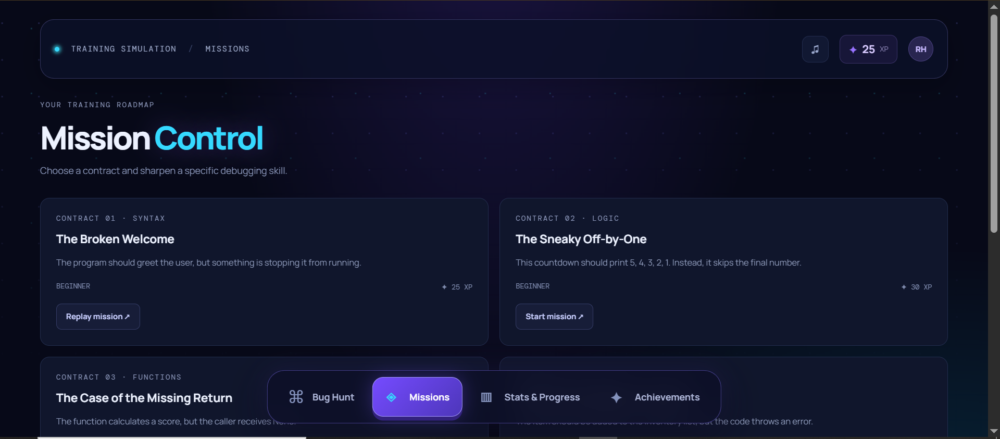
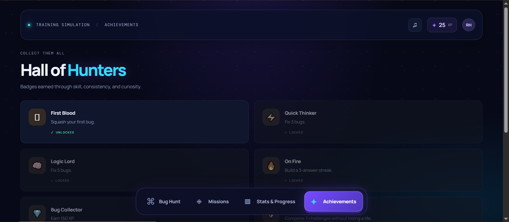

# 🪲 Bug Hunter Simulator: GLITCHWILD


**Reality has bugs. You're the patch.**

Welcome to **Bug Hunter Simulator: GLITCHWILD**, an interactive coding game where players become digital bug hunters tasked with identifying and fixing errors inside a corrupted simulation world.

Explore missions, investigate broken code, solve programming challenges, earn experience points, and improve your debugging skills. Every successfully fixed bug brings you closer to becoming an elite Bug Hunter.

This project combines programming education with game-inspired mechanics, interactive challenges, and an immersive futuristic interface.

---

## 📸 Screenshots

## 📸 Screenshots

<table>
  <tr>
    <td align="center">
      
      <br>
      <b>Bug Hunt</b>
    </td>
    <td align="center">
      
      <br>
      <b>Missions</b>
    </td>
  </tr>
  <tr>
    <td align="center">
      
      <br>
      <b>Stats &amp; Progress</b>
    </td>
    <td align="center">
      
      <br>
      <b>Achievements</b>
    </td>
  </tr>
</table>

---

## 🎮 Project Overview

Bug Hunter Simulator is designed to make learning programming concepts more engaging through interactive debugging missions.

Instead of simply answering programming questions, players take on the role of a hunter investigating corrupted code. Each mission presents a programming problem that requires logical thinking, careful analysis, and problem-solving.

The game uses a futuristic cyber-themed environment with animated elements, glowing interfaces, responsive interactions, and progression mechanics.

### Core Concept

The digital simulation has become unstable. Bugs, errors, and corrupted code are spreading across its sectors.

As a Bug Hunter, your mission is to:

1. Enter the corrupted simulation.
2. Investigate programming errors.
3. Identify the source of each bug.
4. Select or apply the correct solution.
5. Earn XP and rewards.
6. Unlock achievements and improve your hunter rank.

---

## ✨ Features

### 🪲 Interactive Debugging Challenges
- Programming challenges focused on identifying and correcting errors.
- Python-based debugging exercises.
- Multiple challenges with different difficulty levels.
- Hints to help players understand difficult problems.
- Challenge bookmarks for revisiting selected missions.

### ⚡ Hunter Progression System
- Earn experience points (XP) by completing challenges.
- Progress through hunter levels.
- Track successful answers and answer streaks.
- Monitor debugging skill mastery.
- Manage limited lives during gameplay.

### 🏆 Achievements and Rewards
- Unlock achievements through gameplay milestones.
- Track mission and daily objectives.
- Build your debugging record.
- Improve your performance as you complete challenges.

### 🌌 GLITCHWILD Game Environment
- Futuristic cyber-themed visual identity.
- Animated backgrounds and atmospheric effects.
- Floating game elements and glowing interface components.
- Responsive hover and button animations.
- Smooth transitions and interactive feedback.
- Immersive mission introduction and game-world presentation.

### 🔊 Interactive Experience
- Optional sound effects.
- Animated success and error feedback.
- Reward and progression animations.
- Responsive interface for desktop and mobile screens.

### 💾 Local Progress Saving
- Uses browser localStorage to retain supported game progress.
- Saves player information and progression locally.
- No account registration or external database required.

---

## 🛠️ Built With

| Technology | Purpose |
|---|---|
| HTML5 | Page structure and game interface |
| CSS3 | Visual design, animations, and responsive layout |
| JavaScript | Game logic, interactions, and progression |
| Browser localStorage | Local player progress and preferences |

### Development Tools
- Visual Studio Code
- Git and GitHub
- Live Server Extension
- Modern web browser

---

## 🚀 Getting Started

You can run Bug Hunter Simulator locally without installing a backend or configuring API keys.

### Prerequisites

Make sure you have:

- A computer running Windows, macOS, or Linux.
- Visual Studio Code or another code editor.
- A modern web browser.
- Git (optional).
- Live Server Extension for VS Code (recommended).

### Installation

**1. Clone the repository**

```bash
git clone https://github.com/rheillunio2-byte/BugHunterSimulator.git
```

**2. Navigate to the project folder**

```bash
cd BugHunterSimulator
```

**3. Open the project in VS Code**

```bash
code .
```

**4. Run the application**

Open `index.html` using Live Server.

Alternatively, open the HTML file directly in your browser.

**5. Start hunting!**

Enter GLITCHWILD, explore the available challenges, and begin debugging.

---

## 🕹️ How to Play

1. Launch the game and enter the GLITCHWILD simulation.
2. Explore the available debugging challenges.
3. Read the programming problem carefully.
4. Analyze the code and identify the error.
5. Submit your answer.
6. Earn XP and maintain your streak.
7. Use hints when necessary.
8. Unlock achievements and improve your hunter progression.

**Tip:** Take your time when examining code. Successful debugging requires understanding why an error occurs, not just finding the correct answer.

---

## 📂 Project Structure

```text
BugHunterSimulator/
│
├── index.html
├── styles.css
├── app.js
├── README.md
├── CONTRIBUTING.md
├── LICENSE
│
└── images/
    ├── Bug-Hunt.PNG
    ├── Missions.PNG
    ├── Stats-&-Progress.PNG
    └── Achievements.PNG
```

*Note: The structure above represents the intended organization. Some documentation or image files may need to be added if they are not yet included in your local project.*

---

## 🧠 Learning Objectives

Bug Hunter Simulator aims to encourage players to develop:

- Logical and analytical thinking.
- Programming fundamentals.
- Error identification and debugging skills.
- Attention to detail.
- Problem-solving techniques.
- Persistence when solving difficult challenges.

---

## ⚠️ Limitations

- The current version is a frontend-based game.
- Player progress is stored locally in the browser.
- Progress is not automatically synchronized between devices.
- There is no online multiplayer or global leaderboard.
- The available debugging challenges are limited to the implemented content.
- The game does not execute arbitrary Python code in a secure server environment.

---

## 🔮 Future Development

Possible improvements and planned features include:

- [ ] Additional debugging missions and challenge categories.
- [ ] Advanced programming challenges.
- [ ] Boss battles with complex programming errors.
- [ ] Multiple unlockable simulation worlds.
- [ ] More hunter ranks and achievement rewards.
- [ ] Customizable player profiles and cosmetics.
- [ ] Global leaderboard and competitive mode.
- [ ] Mission editor for creating custom debugging challenges.
- [ ] Expanded sound design and game effects.
- [ ] Additional programming languages.
- [ ] Cloud-based player progress synchronization.

---

## 🤝 Contributing

Contributions, suggestions, and improvements are welcome!

If you want to help improve Bug Hunter Simulator, please read the [CONTRIBUTING.md](CONTRIBUTING.md) file before submitting changes.

You can contribute by:
- Reporting bugs.
- Suggesting new game mechanics.
- Creating debugging challenges.
- Improving the user interface.
- Enhancing animations and interactions.
- Improving documentation.

---

## 🔒 Privacy and Security

Bug Hunter Simulator does not currently require user accounts or API keys.

Player progress is stored in the browser using localStorage. This means that saved information is limited to the browser and device being used.

Clearing browser data may remove saved progress. Avoid storing sensitive personal information in the application.

---

## 👨‍💻 Developer

**Developed by RETL**

GitHub: [@rheillunio2-byte](https://github.com/rheillunio2-byte)

Bug Hunter Simulator is an independent educational coding game project created to make programming and debugging more interactive, engaging, and enjoyable.

---

## 📜 License

This project is licensed under the MIT License. See the [LICENSE](LICENSE) file for details.

---

**Reality has bugs. You're the patch.**

*Enter GLITCHWILD. Hunt the errors. Restore the simulation.* 🪲